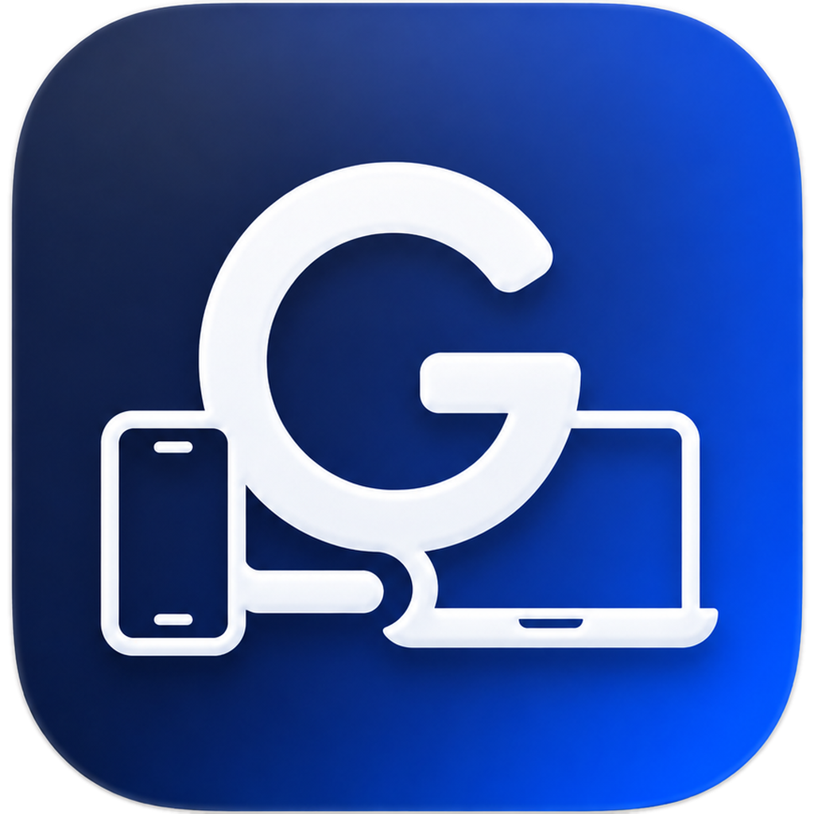

# Genia Link

<strong>Твои устройства. Одна связанная экосистема.</strong>

[English](README.md) · **Русский**

**Genia Link** — независимо разрабатываемая платформа локального взаимодействия устройств **Windows и Android** на основе протокола **GNP/1**.

Задача проекта — обнаружение доверенных устройств в локальной сети и использование их возможностей без обязательной облачной учётной записи или интернет-ретранслятора.

## Что уже проверено?

| Возможность | Статус |
| --- | --- |
| Обнаружение устройств, сопряжение и передача файлов | Проверено в разработке |
| Защищённые аутентифицированные сессии и контроль целостности | Реализовано и проверено в разработке |
| Удалённая печать через доверенное устройство Windows | Проверено на реальном оборудовании в отдельных сценариях |
| Одностраничное сканирование с Android через доверенный шлюз сканера Windows | Проверено на реальном оборудовании в отдельных сценариях |
| Единый интерфейс Windows/Android и локализация RU/EN | В разработке |

Проверка отдельных сценариев не означает готовности публичного релиза, поддержки любого оборудования, сертификации или проведения независимого аудита безопасности.

## Доступность

**Это официальный публичный репозиторий с информацией о проекте.** Здесь размещаются пользовательская документация и публичные новости, **но не** полный исходный код и не материалы подписи программ. Проект находится в активной разработке. EXE и APK здесь пока не распространяются.

## Принципы разработки

- Работа преимущественно в локальной сети и явное доверие к устройствам.
- Криптографическая аутентификация для защищённых операций.
- Бережное обращение с файлами и идентичностями устройств.
- Проверки совместимости и безопасности перед расширением функций.

## Безопасность и права

Не публикуйте в открытых Issues ключи, токены, реальные идентификаторы устройств или подробности уязвимостей. См. [политику безопасности](SECURITY.md).

Материалы проекта предоставлены на условиях **All Rights Reserved**. Публичная доступность не означает разрешения копировать или коммерчески использовать принадлежащие проекту материалы. См. [LICENSE](LICENSE) и [NOTICE.md](NOTICE.md). Права на сторонние компоненты определяются их собственными лицензиями.

**Genia Soft** — публичное название проекта. Оно само по себе не означает наличие зарегистрированного юридического лица.
